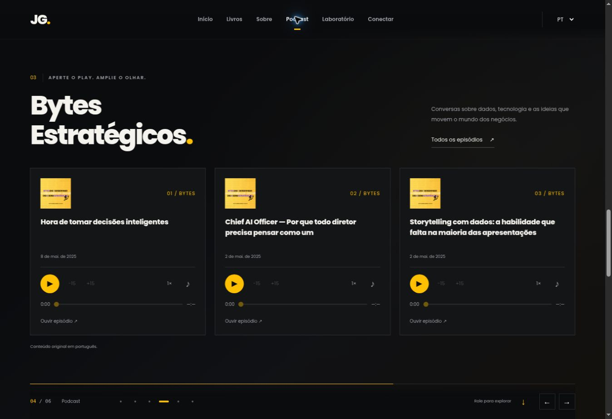

# João Gabriel Corrêa da Silva — Be The Change

Official personal website: books, biography, Bytes Estratégicos, an interactive lab, teaching invitations and social links. Static HTML, CSS and JavaScript, served directly by GitHub Pages. **No build, package install, API key or backend is required.**

## Experience

- Neutral black, yellow `#ffc002`, locally hosted Poppins and six scenes.
- On wide, fine-pointer screens (at least 1100 × 760), native vertical scrolling moves a horizontal track. After native wheel/trackpad or keyboard scrolling ends, the nearest scene snaps into place. `scrollend` and a debounced fallback support different browsers; input is never prevented. Navigation links, URL fragments, previous/next buttons, arrow keys and history address the same sections. Track translation uses the actual panel width, including scrollbar gutters.
- Mobile, touch devices, shorter screens, oversized content and reduced-motion preferences use a normal vertical document. Browser zoom can trigger the same readable fallback. Vertical layouts use proximity snap, so tall sections remain readable; reduced motion disables snapping.
- Local Three.js 0.169.0 adds textured books with covers, a spine and pages, a hexagon network and chart bars. A shared Canvas 2D atmosphere adds 36/96 soft dust particles on mobile/desktop and CSS light shafts, including when WebGL is unavailable. Book changes use separate outgoing and incoming volumes, retaining both textures during the handoff. Scene exits use continuous opacity curves and time-based easing, including fast scroll/anchor jumps. Book anchors are independent of the departing HTML panel, so books recede and fade in place instead of slipping off-screen. The scene follows scroll progress, responds to the pointer, pauses in hidden tabs and while a demo is open, and uses a capped pixel ratio and frame rate. Mobile orientation is opt-in on supported secure devices.
- CSS book covers remain available when WebGL is unavailable, initialization fails, a texture fails or the context is lost. CSS fallback also animates separate outgoing and incoming books over 1.15 seconds and fades book stages near scene/viewport boundaries. Rapid selections ignore stale image loads. Reduced motion disables these transitions and skips Three.js initialization entirely.
- PT/EN/ES UI strings, persistent language choice and `?locale=pt-BR`, `?locale=en`, `?locale=es` links. Book edition is a separate choice. Spanish UI explicitly identifies the English edition; no Spanish book edition is implied.
- Podcast uses custom, keyboard-accessible controls: play/pause, ±15 seconds, seek, mute and playback speed. Audio has no native controls, no preloading or autoplay, and only one episode plays at a time. Loading, timeout and retry states are localized; changing the UI language preserves playback.
- The curated lab contains all eight requested public repositories, four cards per page, with code links and star counts. Demos load in a sandboxed dialog only after a click. Closing removes the iframe to stop audio and computation and restores scroll/focus. A separate-tab link remains available if an embed cannot load. Original demo languages and educational context are identified.
- Professional copy focuses on AI, financial intelligence and industrial digital transformation. Teaching copy reflects corporate talks/workshops and invites corporate and academic guest sessions. There are no private company project names, screenshots, datasets or performance claims.
- The existing RSS2JSON and public GitHub endpoints refresh content. Timeouts, empty responses and API errors are handled. Real dated snapshots in `data/` provide a fallback; the snapshot date is displayed when used. External feed text is never injected as HTML, and links are validated before use.

## Files

| File                  | Responsibility                                                            |
| --------------------- | ------------------------------------------------------------------------- |
| `index.html`          | Semantic content, six scenes, metadata and no-JavaScript links            |
| `style.css`           | Responsive layout, typography and CSS book fallback                       |
| `page.js`             | i18n, book catalog, social links and feed loading/rendering               |
| `js/scroll.js`        | Scene navigation, anchors, keyboard, focus and layout fallback            |
| `js/audio-player.js`  | Custom media controls and playback coordination                           |
| `js/book-motion.js`   | CSS book transitions and stale image-load protection                      |
| `js/portfolio.js`     | Curated demonstrations, pagination and modal lifecycle                    |
| `js/atmosphere.js`    | Shared dust, lighting movement and fallback book-stage fades              |
| `js/scene-motion.js`  | Continuous scene opacity, time easing and stable book anchors             |
| `js/scene3d.js`       | Optional Three.js background and lifecycle                                |
| `js/vendor/`          | Pinned Three.js module and its MIT license                                |
| `assets/`             | Local WOFF fonts, WebP images, favicon, Open Graph image and font license |
| `data/`               | Public feed snapshots captured on 7 November 2026                         |
| `tests/site.test.cjs` | Dependency-free Node regression checks                                    |

Original root images remain available to preserve existing external URLs. The site itself uses optimized local assets. The `CNAME` and existing GitHub Pages hosting configuration are preserved.

## Book catalog

| Book                           | Edition   | Supplied destination                    |
| ------------------------------ | --------- | --------------------------------------- |
| O que os dados não dizem       | Português | https://www.amazon.com.br/dp/B0F3VKYWFN |
| What the data doesn’t tell you | English   | https://www.amazon.com.br/dp/B0H1T1PMW9 |
| Análise de dados               | Português | https://www.amazon.com.br/dp/B0DZNB1LM8 |
| Data analysis                  | English   | https://www.amazon.com/dp/B0F1DB4QBJ    |

The current English storytelling cover comes from the supplied ASIN and is marked “Extended Edition.” Its title/subtitle follow that cover. Existing PT artwork comes from this repository. The other supplied ASIN covers were retrieved from Amazon’s public image service; the downloadable versions are 500 px high. Replace the matching WebP files with higher-resolution publisher artwork when available. No prices or availability claims are hardcoded.

An email link is intentionally absent: no public contact email was supplied or found in the original site. LinkedIn is the primary contact. Add a verified public address to the contact section when available.

## Local preview and checks

Serve the repository over HTTP (ES modules cannot load from `file://`):

```sh
python3 -m http.server 8000
```

Open `http://localhost:8000/?locale=pt-BR`. Test optional locale and fragment links such as `?locale=en#book`. Asset paths are relative, so GitHub Pages project subpaths are also supported.

```sh
node --check page.js
for file in js/*.js; do node --check "$file"; done
node --test tests/*.test.cjs
```

The GitHub Actions check runs these commands on pull requests and pushes to `main`.

## Preview




## Verification and limitations

Automated checks cover locale variants, complete translated UI labels, the four ASIN mappings, asset paths, unsafe URL rejection, external text handling, malformed API responses, bundled snapshots and third-party licenses. Regression tests also cover single-episode playback, bounded seeking, rejected or stalled play requests, cancellation races, late cover loads and all eight demo entry paths. Browser QA covers desktop wheel snap, edition transitions, real podcast playback/speed/episode switching, PT/EN/ES, modal execution and mobile/tablet layouts. The original Simply Similar example returned 52.63% inside the dialog. All eight public demo entry URLs returned HTTP 200 without frame restrictions on 7 November 2026.

The cloud QA browser disables WebGL. The actual GPU rendering, hardware frame rate and phone gyroscope therefore require a WebGL-enabled browser/device check; CSS fallback was directly observed. No Lighthouse score or real-device performance result is claimed. External audio playback also depends on the podcast hosting service and browser codec support.

## Atmosphere and fade behavior

The ambient shafts use feathered gradients and haze for a volumetric-light appearance, without a ray-marching/postprocessing pass. Dust uses one cached glow sprite, three depth layers, a capped pixel ratio and 20/30 FPS mobile/desktop limits. Both light movement and dust pause when the tab is hidden or a demo is open. Reduced motion keeps a static light/dust composition with fewer particles and disables book-stage fading.

`js/scene-motion.js` contains easing shared with the scene. Regression checks cover continuous opacity at the previous cut points, complete fade-out/return, fast navigation, equivalent results at different frame rates, and stable anchors across panel widths. GPU rendering still needs a WebGL-enabled device check; the cloud browser can inspect the independent atmosphere and CSS book fades directly.

## Public sources and demo entry points

Only public examples are described. The professional positioning and corporate teaching experience were supplied by the author. The linked articles are examples of published work, not claims about private corporate deployments:

- [Simply Similiar: Part 2 — 9 November 2024](https://www.linkedin.com/pulse/simply-similiar-part-2-jo%C3%A3o-gabriel-corr%C3%AAa-da-silva-3qkif)
- [Machine Inside Out — 15 November 2024](https://www.linkedin.com/pulse/machine-inside-out-how-artificial-neural-networks-corr%C3%AAa-da-silva-6fzaf)
- [Didactics applied to the corporate environment — 30 May 2024](https://www.linkedin.com/pulse/didactics-applied-corporate-environment-how-improve-corr%C3%AAa-da-silva-ipdse)

| Repository                 | Live entry                                                 | Example data/context                                                                      |
| -------------------------- | ---------------------------------------------------------- | ----------------------------------------------------------------------------------------- |
| data2music                 | https://jgabriel2302.github.io/data2music/                 | Public Trending Movies CSV or visitor-provided sample                                     |
| aco-a-star                 | https://jgabriel2302.github.io/aco-a-star/                 | Simulated routes; needs WebGL                                                             |
| decision-tree-for-projects | https://jgabriel2302.github.io/decision-tree-for-projects/ | Generated strategic projects; original app also offers a public industrial-safety example |
| risk-means-nn              | https://jgabriel2302.github.io/risk-means-nn/              | Generated probabilities and impacts                                                       |
| previsao-ebitda            | https://jgabriel2302.github.io/previsao-ebitda/exemple/    | Public Petrobras data, 2019–2024; educational forecasting                                 |
| machine-Inside-out         | https://jgabriel2302.github.io/machine-Inside-out/exemple/ | Visitor-drawn digits                                                                      |
| simply-similar             | https://jgabriel2302.github.io/simply-similar/exemple/     | Editable sample texts; `/exemple/en/` for English                                         |
| carro-autonomo             | https://jgabriel2302.github.io/carro-autonomo/             | Simulated driving and sensors                                                             |

Demos are the author's existing independently hosted applications, not copies maintained in this repository. Their interfaces, external dependencies and browser requirements remain their own. A successful iframe load cannot prove every remote app feature works; the UI always offers a separate-tab fallback.

## Rights

Site content and original artwork © João Gabriel Corrêa da Silva. All rights reserved. Copying, modification, redistribution or commercial use requires the author’s permission. Third-party dependencies retain their included licenses: Three.js (MIT), Poppins (SIL OFL).
